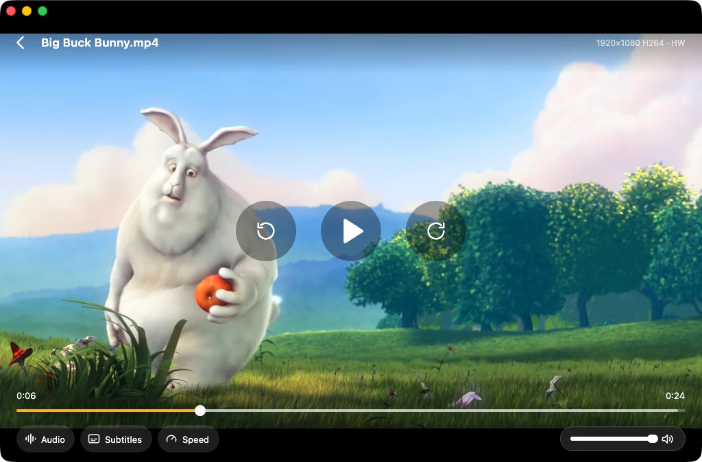
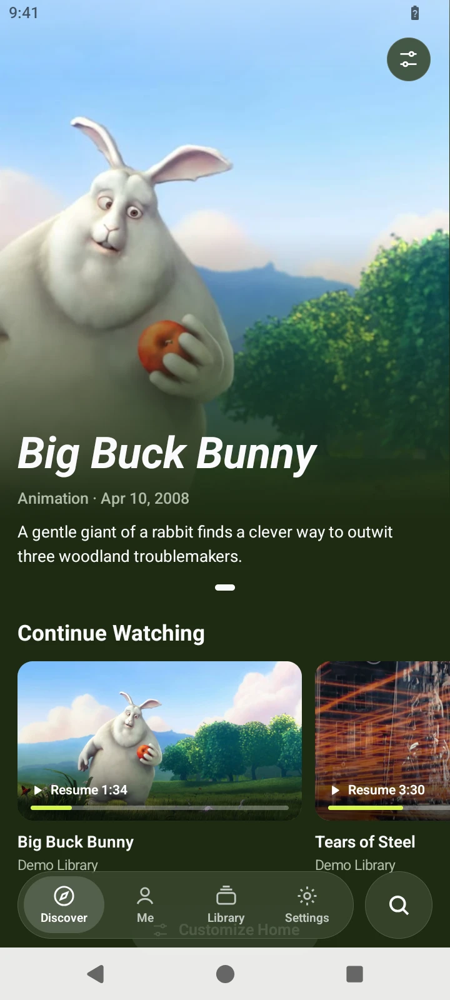
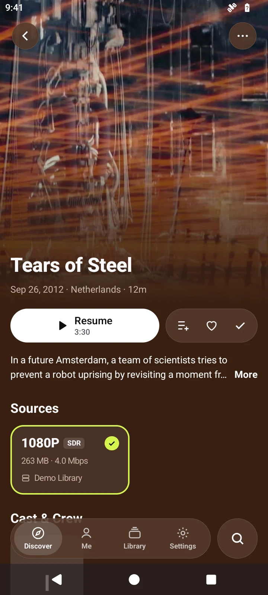

# Cinehaus

Cinehaus is a video player and Emby client for **macOS and Android**. Open a video on your device, or connect your Emby servers to browse and watch your library in one app.

**[Download Cinehaus](https://github.com/gengjiawen/Cinehaus-Release/releases)**

| Platform | Installer | Requirements |
| --- | --- | --- |
| macOS | DMG | Apple silicon, macOS 12 or later |
| Android | APK | 64-bit ARM, Android 8.0 or later |

## What you can do

- **Play your videos.** Open local files or stream original files from Emby. Switch audio and subtitle tracks, and show two subtitles at once.
- **Browse across Emby servers.** See available versions on one title page, pick up where you left off, and find other films in the same series.
- **Make Discover your own.** Arrange your Continue Watching section alongside IMDb charts and Douban lists.
- **Watch offline.** Download movies or selected episodes when your Emby server allows it, and resume interrupted downloads.

## Android screenshots

<table>
  <tr>
    <td></td>
    <td></td>
  </tr>
  <tr>
    <td>Discover and Continue Watching</td>
    <td>Movie details and sources</td>
  </tr>
</table>

Film stills from [Big Buck Bunny](https://peach.blender.org/about/), © 2008 Blender Foundation / www.bigbuckbunny.org, and [Tears of Steel](https://mango.blender.org/sharing/), © Blender Foundation / mango.blender.org. Both are licensed under [CC BY 3.0](https://creativecommons.org/licenses/by/3.0/).
